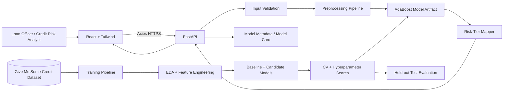
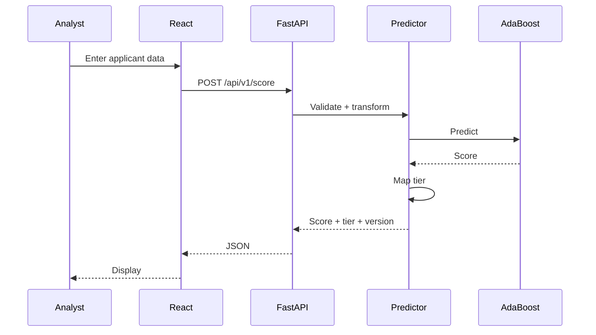

# Micro-Loan Risk Scorer — Complete Polaris Documentation

This package follows the supplied Polaris master prompt. Its Advanced Data Science track explicitly requires problem formulation, dataset design, EDA, feature engineering, statistical analysis, model selection, baseline/advanced models, hyperparameter optimization, cross-validation, comparison, explainability, error analysis, experiment tracking, model evaluation and business impact. The master prompt also requires the lifecycle Data → Cleaning → EDA → Features → Training → Validation → Evaluation → Deployment. Where the project brief does not provide exact dataset schema, counts, measured metrics or infrastructure pricing, those values are deliberately not fabricated.


---

# 01 Project Overview

# Micro-Loan Risk Scorer — Project Overview
**Track:** Advanced Data Science | **Domain:** FinTech/Lending | **Duration:** 12 weeks | **Team:** 2 | **Level:** Intermediate

## Goal
Build an AdaBoost-based credit-risk scorer that flags high-default-risk microloan applicants and exposes risk-tier scoring through a FastAPI service with a React frontend.

## Inputs and Deliverables
- Give Me Some Credit dataset, as specified in the project brief.
- Research grounding: *A Decision-Theoretic Generalization of On-Line Learning and an Application to Boosting*, Journal of Computer and System Sciences, 1997.
- Required split: 80/20 stratified train-test.
- Required outputs: trained AdaBoost model, risk-tier scoring API, model card.
- Required evaluation: ROC-AUC and precision/recall at a chosen threshold.
- Stack: Python, JavaScript, scikit-learn, FastAPI, React, pandas, NumPy, matplotlib, Tailwind CSS, Axios.

## Core Lifecycle
Data → Cleaning → EDA → Features → Training → Validation → Evaluation → Deployment.

## MVP
Dataset validation, EDA, feature engineering, baseline, AdaBoost, tuning, cross-validation, test evaluation, threshold/risk tiers, FastAPI, React, model card, tests and deployment.

## Important Assumption
The exact dataset schema, target definition, row count, feature meanings and class distribution must be taken from the actual dataset/documentation. They are not fabricated here. The “micro-loan” business context is an intended application context and must be assessed for dataset fit.

## Product Boundary
This is a decision-support prototype, not an autonomous loan-approval system.


---

# 02 BRD

# Business Requirements Document
## Problem
Lending teams need a repeatable signal for prioritizing applicants with elevated estimated default risk. The product provides a model-driven risk score/tier for human review.

## Personas
| Persona | Goal | Pain Point |
|---|---|---|
| Loan Officer | Prioritize applications | Manual/inconsistent screening |
| Credit Risk Analyst | Assess model and applicant risk | Need transparent metrics and reproducibility |

## Objectives
1. Train AdaBoost on the specified dataset.
2. Use an 80/20 stratified train-test split.
3. Perform CV/tuning only inside the training partition.
4. Select and document an operating threshold.
5. Serve scoring through FastAPI.
6. Provide a React analyst UI.
7. Publish a model card.

## Requirements
| ID | Requirement | Priority | Acceptance |
|---|---|---|---|
| BR-001 | Ingest dataset | Must | Source/version/schema documented |
| BR-002 | Validate data | Must | Missingness, duplicates, types and ranges checked |
| BR-003 | Perform EDA | Must | Findings and plots documented |
| BR-004 | Establish baseline | Must | Baseline metrics recorded |
| BR-005 | Train AdaBoost | Must | Versioned artifact produced |
| BR-006 | Tune and compare | Must | CV/search process documented |
| BR-007 | Final test evaluation | Must | Test untouched until final evaluation |
| BR-008 | Risk tiers | Must | Threshold/tier mapping documented |
| BR-009 | Scoring API | Must | Validated versioned endpoint |
| BR-010 | React UI | Must | End-to-end scoring works |
| BR-011 | Model card | Must | Use, data, metrics, limits documented |
| BR-012 | Experiment tracking | Should | Run configuration and metrics recorded |

## NFRs
Performance, reliability, security, accessibility, scalability, cost and responsible-use limitations must be documented. Avoid real PII in the student environment.

## Risks
Dataset/business mismatch, class imbalance, leakage, threshold misuse, overfitting, historical bias and distribution shift.


---

# 03 PRD

# Product Requirements Document
## Product Goal
Give loan officers and credit-risk analysts a fast, consistent risk-tier signal while preserving human judgment.

## Features
- Applicant scoring form.
- Risk score/probability where supported.
- Risk tier.
- Model version.
- Model performance dashboard.
- Model card.
- API.
- Future batch scoring.

## User Stories
**US-001:** As a loan officer, I want to submit applicant information and receive a risk tier so I can prioritize review.
**US-002:** As an analyst, I want to see model version and threshold so I know which model produced a result.
**US-003:** As a risk analyst, I want ROC-AUC and precision/recall at the operating threshold so I can assess model quality.
**US-004:** As a data scientist, I want reproducible training configuration so I can reproduce results.
**US-005:** As an analyst, I want a model card so I understand intended use and limitations.

## Product Principles
Score first, decide second; explicit threshold; version every model; keep the test set untouched; do not present prediction as certainty.


---

# 04 UX Requirements

# UX Requirements
## Information Architecture
Overview → Applicant Scoring → Risk Result → Model Performance → Model Card → Limitations.

## Scoring Screen
Grouped fields, labels, validation, submit/reset, loading and error states.

## Result Screen
Show risk score, risk tier, model version, timestamp, threshold interpretation and a prominent decision-support disclaimer.

## Performance Screen
Show ROC-AUC, precision, recall, confusion matrix, threshold rationale and train/test split.

## Accessibility
Keyboard navigation, semantic labels, readable errors, responsive design and risk indicators that do not rely only on color.

## Required States
Loading, success, empty, validation error, API error and unavailable-service state.


---

# 05 TRD

# Technical Requirements Document
## Architecture
Training is a Python data-science workflow producing a versioned artifact. Serving is a FastAPI service. React is the analyst UI.

## Requirements
| ID | Technical Requirement |
|---|---|
| TR-001 | Reproducible ingestion |
| TR-002 | Data/schema validation |
| TR-003 | Leakage-safe preprocessing pipeline |
| TR-004 | EDA artifacts |
| TR-005 | Baseline |
| TR-006 | AdaBoost |
| TR-007 | Hyperparameter optimization |
| TR-008 | CV only within training data |
| TR-009 | Held-out test evaluation |
| TR-010 | Model artifact/versioning |
| TR-011 | Risk-tier mapping |
| TR-012 | FastAPI scoring endpoint |
| TR-013 | React UI |
| TR-014 | Model card |
| TR-015 | Automated tests |

## Split Protocol
80% stratified training / 20% untouched test. Fit preprocessing on training data only. Use CV and tuning only within the 80% training partition. Select final model and threshold, then evaluate on the untouched test set.

## GPU Constraint
AdaBoost with tree-based weak learners is CPU-friendly; GPU should not become an artificial dependency.


---

# 06 HLD

# High-Level Design
## Architecture

## Responsibilities
React: UI. FastAPI: validation/inference. Pipeline: transformations. AdaBoost: prediction. Tier mapper: operational category. Training pipeline: EDA, features, model selection, tuning and evaluation.

## Scalability
Keep FastAPI stateless. Scale horizontally only when traffic justifies it. Do not introduce microservices or databases without a demonstrated need.

## Reliability
Validate requests, load the artifact at startup, expose health checks, use stable error codes and make prediction deterministic for a fixed artifact/input.

## Security
HTTPS, validation, rate limiting when public, secret management, dependency scanning and no sensitive data in logs.


---

# 07 Database Data Design

# Database / Data Design
## MVP Decision
A database is not mandatory. The core product can be stateless: request → preprocessing → model → response.

## Model Artifact Metadata
Store model name/version, dataset identifier/version, training date, feature schema, preprocessing version, hyperparameters, threshold and evaluation metrics.

## Optional Prediction History
If history is required, store prediction ID, model version, non-reversible input hash, score, tier, timestamp and operational metadata excluding raw sensitive inputs.

## Data Pipeline
Raw dataset → validated dataset → training representation → feature matrix → model artifact.

Do not create a database merely to satisfy a checklist.


---

# 08 API Specification

# API Specification
Base URL: `/api/v1`

## GET /health
Returns service/model health.

## POST /score
Request:
```json
{"features":{"<dataset_feature_1>":0,"<dataset_feature_2>":0}}
```
Exact feature names must come from the actual dataset schema.

Response:
```json
{"riskScore":0.0,"riskTier":"LOW|MEDIUM|HIGH","modelVersion":"adaboost-v1","timestamp":"ISO-8601"}
```

## GET /model
Returns non-sensitive model metadata and evaluation metrics.

## GET /model-card
Returns model-card information or a link.

## Errors
Use structured errors with code, message and request ID. 422/400 for validation, 429 for rate limit, 503 for unavailable model, 500 for unexpected server errors.


---

# 09 LLD

# Low-Level Design
## Training
```text
training/
  data/ ingestion.py validation.py split.py
  eda/ distributions.py missingness.py target_analysis.py
  features/ preprocessing.py feature_engineering.py
  models/ baseline.py adaboost.py tuning.py evaluation.py threshold.py
  experiments/
  artifacts/
```

## Backend
```text
backend/app/
  main.py schemas.py
  routes/health.py scoring.py model.py
  services/predictor.py model_registry.py
  middleware/error_handler.py
```

## Frontend
```text
frontend/src/
  components/
  pages/
  services/
  hooks/
  types/
  utils/
```

## Predictor
load_model → validate_features → transform → predict → map_risk_tier → return metadata.

## Sequence



---

# 10 Advanced Data Science Architecture

# Advanced Data Science Architecture
## Problem Formulation
Supervised binary classification of the dataset's documented default-risk target.

## Dataset Design
Document exact source/version, row count, features, target, data types, missingness, duplicates, class balance, leakage risks and applicability to the micro-loan context. Do not invent schema details.

## EDA
Target distribution, missingness, distributions, outliers, correlations where appropriate, feature-target relationships and train/test distribution comparison. Do not infer causality from correlation.

## Feature Engineering
Use leakage-safe transformations. Every engineered feature must have a rationale. Address missingness, outliers, scaling where required, feature selection and potential leakage.

## Baseline
Use a simple baseline such as a dummy classifier and/or logistic regression. Compare it with AdaBoost.

## Primary Model
AdaBoost classifier, grounded conceptually in the supplied 1997 boosting paper. Explain weak learners, iterative boosting, emphasis on difficult observations and ensemble prediction. Do not claim the paper specifies the exact modern scikit-learn implementation.

## Candidate Models
AdaBoost is mandatory. Optional comparison: Random Forest, Gradient Boosting or HistGradientBoosting.

## Training Protocol
80/20 stratified train-test split. CV, tuning and threshold selection happen only inside the training partition. The test partition remains untouched until final evaluation.

## Hyperparameter Optimization
Investigate number of estimators, learning rate and base-estimator complexity. Record search space, CV strategy, selection metric and chosen configuration.

## Evaluation
Required: ROC-AUC and precision/recall at a chosen threshold. Also report confusion matrix, ROC/PR curves, class counts and threshold rationale.

## Threshold
Select threshold using training/CV, not the final test set. Explain precision/recall trade-offs.

## Explainability and Error Analysis
Use appropriate feature importance, false-positive/false-negative analysis and boundary-case analysis. Feature importance is not causality.

## Experiment Tracking
Record run ID, dataset version, split seed, pipeline version, model, hyperparameters, CV strategy, metrics, threshold and artifact version.

## Business Impact
Translate results into flagged volume, captured defaults at threshold, false-positive workload and evidence required before production use.


---

# 11 Security

# Security Design
Authentication/authorization should be added when the API is deployed beyond local development. Use roles such as LOAN_OFFICER, CREDIT_RISK_ANALYST and ADMIN if role separation is needed.

## Controls
- FastAPI/Pydantic input validation.
- HTTPS.
- Rate limiting for public endpoints.
- CORS restrictions.
- Secure secrets.
- Dependency scanning.
- Secure logging with no raw applicant records.
- No real PII for the student demo.
- Protect and integrity-check serialized model artifacts.
- Pin dependencies.

## ML Security
Consider data poisoning, leakage, distribution shift, adversarial input manipulation, historical bias and threshold misuse.

## Responsible Use
The score is not a guarantee of default and must not be presented as an autonomous lending decision.


---

# 12 Testing Strategy

# Testing Strategy
## Unit
Validation, transformations, tier mapping, threshold logic, predictor service.

## Integration
FastAPI + artifact + preprocessing; React + API contract.

## API
Valid request, missing field, wrong type, malformed payload, model unavailable, unknown route and rate limit.

## UI
Form, validation, loading, success, failure and responsive behavior.

## Data Science
Schema validation, reproducible split, no preprocessing leakage, CV correctness, artifact loading and prediction consistency.

## Sample Test Cases
| ID | Scenario | Expected |
|---|---|---|
| TEST-001 | Valid score request | 200 + score + tier + model version |
| TEST-002 | Missing feature | 422 |
| TEST-003 | Wrong type | 422 |
| TEST-004 | Model unavailable | 503 |
| TEST-005 | Threshold boundary | Documented tier |
| TEST-006 | Same input/artifact | Deterministic result |
| TEST-007 | Fixed split seed | Reproducible split |
| TEST-008 | Preprocessing | No test-data fitting |
| TEST-009 | Backend unavailable | UI error state |
| TEST-010 | Model metadata | Correct version/metrics |

## Performance
Measure cold start, warm inference, p50/p95 latency and concurrent requests.


---

# 13 CICD

# CI/CD
PR → lint → unit tests → data/ML tests → API tests → frontend tests → security/dependency scan → build → artifact validation → deployment → smoke tests.

ML quality gates: schema validation, reproducibility check, artifact creation, metrics presence, threshold documentation and model-card update.

Use `main` as stable and `feature/*` branches for work. Tag application/model versions for releases.


---

# 14 Observability

# Observability
## Logs
Request ID, endpoint, status, latency, model version and error code. Never log raw applicant records.

## Metrics
Request rate, error rate, p50/p95 latency, model-load failures, prediction count, risk-tier distribution and model-version usage.

## ML Monitoring
Future production-like extension should monitor input drift, missingness drift, prediction distribution, outcome-based performance when labels arrive, calibration and subgroup performance where appropriate.

## Health
`GET /health` should fail when the required model artifact cannot be loaded.


---

# 15 Deployment

# Deployment Architecture
```text
User → React Static App → HTTPS → FastAPI → Preprocessing + AdaBoost Artifact
```
A single containerized FastAPI service is sufficient for the MVP. React can be deployed as a static application.

Package/version the preprocessing artifact, AdaBoost model, metadata and threshold together.

GPU is not required for the core AdaBoost workflow; use CPU-first deployment. Future scale may add a model registry, object storage, API gateway, autoscaling and drift monitoring only when justified.

Maintain previous model/application versions for rollback.


---

# 16 Cost Analysis

# Cost Analysis
## MVP Drivers
- FastAPI compute.
- React static hosting.
- Model artifact storage.
- Optional monitoring and CI/CD.

No LLM/vector-database cost is required for the stated project.

## GPU
GPU is listed as a constraint, but AdaBoost should be evaluated CPU-first. Measure training time before requesting GPU infrastructure.

## Optimization
Keep inference stateless, load the model once, avoid unnecessary databases and scale only when traffic requires it.


---

# 17 Roadmap

# 12-Week Roadmap
| Phase | Weeks | Deliverable |
|---|---:|---|
| Research | 1 | Paper + dataset study |
| Requirements | 2 | BRD, PRD, UX |
| Data | 3 | Ingestion, validation, EDA |
| Features | 4 | Leakage-safe pipeline |
| Baseline | 5 | Baseline metrics |
| AdaBoost | 6 | Primary model |
| Tuning | 7 | CV + model comparison |
| Evaluation | 8 | Threshold + final test report |
| API | 9 | FastAPI |
| Frontend | 10 | React |
| Testing/Deployment | 11 | CI/CD + deployed demo |
| Finalization | 12 | Model card + presentation |

Definition of Done: implemented, tested, documented, integrated and demonstrable.


---

# 18 Team Responsibilities

# Team Responsibilities
## Student 1 — Data Science / Modeling
Dataset validation, EDA, feature engineering, baseline, AdaBoost, tuning, CV, evaluation, error analysis, model card.

## Student 2 — ML Engineering / Full Stack
FastAPI, model loading/versioning, React, Axios, Tailwind, API/UI testing and deployment.

## Shared
HLD/LLD, security, CI/CD, traceability, architecture decisions, presentation. Both students must understand the full lifecycle.


---

# 19 GitHub Repository Structure

# GitHub Repository Structure
```text
micro-loan-risk-scorer/
├── docs/
├── training/
│   ├── notebooks/
│   ├── src/
│   ├── configs/
│   └── artifacts/
├── backend/
│   ├── app/
│   └── tests/
├── frontend/
│   ├── src/
│   └── tests/
├── data/
├── models/
├── tests/
├── scripts/
├── .github/workflows/
├── README.md
├── CONTRIBUTING.md
├── LICENSE
└── .gitignore
```
Do not commit private/restricted datasets, credentials or secrets.


---

# 20 README

# Micro-Loan Risk Scorer
## Problem
Build an AdaBoost-based credit-risk scorer that flags high-default-risk microloan applicants.

## Solution
Python/scikit-learn training pipeline + FastAPI scoring service + React analyst UI.

## Features
EDA, feature engineering, baseline, AdaBoost, CV/tuning, ROC-AUC, precision/recall at chosen threshold, risk tiers, API, UI and model card.

## Research
Grounded in the supplied 1997 AdaBoost reference. Explain the relationship to modern scikit-learn implementation without claiming the paper specifies it.

## Dataset
Give Me Some Credit dataset, as specified in the brief. Record exact source/version/schema from the actual dataset.

## Local Setup
Document Python environment, dependencies, model artifact, environment variables, FastAPI start command and React start command.

## Testing
Run backend, model and frontend tests.

## Disclaimer
Educational decision-support prototype; not for real lending without appropriate validation, governance, security, compliance and human oversight.


---

# 21 Model Card

# Model Card — AdaBoost Credit Risk Scorer
## Model Details
AdaBoost binary classifier implemented with scikit-learn. Intended to flag elevated estimated default risk.

## Intended Use
Educational credit-risk modeling, analyst prioritization and ML lifecycle demonstration.

## Out of Scope
Autonomous approval/rejection, real lending decisions, regulatory claims or use outside the validated population.

## Data
Give Me Some Credit dataset as specified by the brief. Final card must record exact source/version, sample count, features, target, missingness and class balance from the actual dataset.

## Split
80/20 stratified train-test. CV and tuning occur only within the training partition.

## Evaluation
ROC-AUC, precision and recall at the selected threshold, plus confusion matrix and ROC/PR curves.

## Threshold
Record selected threshold, selection objective and training/CV procedure.

## Limitations
Dataset population may not represent micro-loan applicants; historical labels may contain bias; future distribution shift can reduce performance; score is not certainty.

## Ethical Considerations
Discuss fairness, proxy variables, data minimization, human oversight and responsible use.

## Monitoring
Input drift, missingness drift, prediction distribution, calibration and outcome-based performance when labels become available.

## Versioning
Prediction must be traceable to model, preprocessing and threshold versions.


---

# 22 ADRs

# Architecture Decision Records
## ADR-001 — FastAPI
Use FastAPI because it keeps model serving close to the Python/scikit-learn artifact and provides typed validation.

## ADR-002 — React
Use React + Tailwind for the analyst-facing product UI.

## ADR-003 — AdaBoost
AdaBoost is the primary model because it is the explicit project objective and connects the supplied boosting reference to a modern implementation.

## ADR-004 — 80/20 Stratified Split
Required by the project brief and preserves class proportions.

## ADR-005 — CV Only on Training
Prevents test-set leakage and preserves an honest final evaluation.

## ADR-006 — CPU First
GPU is not required for the core AdaBoost workload.

## ADR-007 — No Mandatory Database
Avoid architecture complexity when the MVP can be stateless.

## ADR-008 — Human Decision Support
The model provides a risk signal, not an autonomous lending decision.


---

# 23 Traceability

# Traceability Matrix
| Business | Feature | User Story | Technical | API | Component | Artifact | Test |
|---|---|---|---|---|---|---|---|
| BR-001 | Dataset ingestion | US-004 | TR-001 | N/A | Training | Dataset | TEST-007 |
| BR-002 | Data validation | US-004 | TR-002 | N/A | Validation | Clean data | TEST-008 |
| BR-003 | EDA | US-003 | TR-004 | N/A | EDA | Plots/report | Review |
| BR-004 | Baseline | US-003 | TR-005 | GET /model | Training | Metrics | Model tests |
| BR-005 | AdaBoost | US-003 | TR-006 | GET /model | Model | Artifact | Model tests |
| BR-006 | Tuning | US-004 | TR-007/008 | GET /model | Experiments | Run metadata | Leakage tests |
| BR-007 | Test evaluation | US-003 | TR-009 | GET /model | Evaluation | Test metrics | TEST-008 |
| BR-008 | Risk tier | US-001 | TR-011 | POST /score | Tier mapper | Threshold | TEST-005 |
| BR-009 | API | US-001 | TR-012 | POST /score | FastAPI | Artifact | TEST-001..004 |
| BR-010 | UI | US-001 | TR-013 | POST /score | React | UI | E2E |
| BR-011 | Model card | US-002 | TR-014 | GET /model-card | Docs | Model card | Review |


---

# 24 Interview Questions

# Interview Preparation
## Product — 20
1. What problem is solved? 2. Who uses it? 3. Why risk tiers? 4. Why not autonomous approval? 5. What is MVP? 6. Key business metric? 7. Largest product risk? 8. What if performance drops? 9. Why threshold? 10. How does an officer use it? 11. What next? 12. What is out of scope? 13. How validate value? 14. False-positive handling? 15. False-negative handling? 16. Why model card? 17. Why model version? 18. How add batch scoring? 19. How monitor? 20. What makes it production-ready?

## Technical — 20
1. Why AdaBoost? 2. How does boosting work? 3. What is a weak learner? 4. Why stratify? 5. Why untouched test set? 6. What is CV? 7. How can preprocessing leak? 8. How tune? 9. Why ROC-AUC? 10. Why precision/recall? 11. How select threshold? 12. What is class imbalance? 13. How analyze errors? 14. How version artifacts? 15. Why FastAPI? 16. How validate inputs? 17. How load safely? 18. How scale inference? 19. Why no database? 20. How test prediction?

## Architecture — 10
1. Explain training architecture. 2. Explain inference architecture. 3. Why separate training/serving? 4. Why CPU-first? 5. How add model registry? 6. How support versions? 7. How rollback? 8. How monitor drift? 9. How add batch scoring? 10. When should architecture evolve?

## Scenarios — 10
1. High AUC but poor recall at threshold? 2. Missing production feature? 3. Artifact unavailable? 4. Distribution shift? 5. Frequent analyst disagreement? 6. AUC improves but recall falls? 7. GPU unavailable? 8. Test set accidentally tuned? 9. API slows? 10. Business asks for automatic rejection?

## Follow-up — 10
Probability vs score; threshold dependence of AUC; misleading accuracy; causality vs feature importance; calibration; model drift; data drift; model card; reproducibility; champion/challenger.


---

# 25 Viva Questions

# Viva / Project Defense
## Beginner — 20
Credit risk, classification, AdaBoost, weak learner, feature, target, train/test split, stratification, ROC-AUC, precision, recall, confusion matrix, FastAPI, React, pandas, scikit-learn, artifact, threshold, model card, human oversight, dataset fit.

## Intermediate — 20
AdaBoost mechanism, difficult observations, preprocessing leakage, CV, threshold selection, why AUC alone is insufficient, precision/recall, baseline comparison, tuned parameters, overfitting, model selection vs final evaluation, error analysis, drift, versioning, FastAPI, invalid input, database decision, health endpoint, deployment.

## Advanced — 20
Calibration, severe imbalance, cost-sensitive threshold, leakage tests, population shift, subgroup evaluation, bias, champion/challenger, rollback, artifact compatibility, delayed labels, limits of feature importance, horizontal scaling, batch inference, registry, artifact security, deprecation, alternative model selection, production evidence, relationship between the 1997 paper and modern implementation.


---

# 26 Project Quality Score

# Final Project Quality Score
| Dimension | Score |
|---|---:|
| Business Value | /10 |
| Problem Clarity | /10 |
| UX | /10 |
| Technical Complexity | /10 |
| Architecture | /10 |
| Code Quality | /10 |
| Scalability | /10 |
| Security | /10 |
| Testing | /10 |
| Cloud/Deployment | /10 |
| AI/ML Quality | /10 |
| Innovation | /10 |
| Documentation | /10 |
| Production Readiness | /10 |

## Advanced Data Science Review
Also score dataset understanding, EDA, feature engineering, statistical reasoning, baseline, AdaBoost, hyperparameter optimization, CV correctness, model comparison, threshold selection, ROC-AUC, precision/recall, error analysis, explainability, experiment reproducibility and model-card quality.

## Final Review
Total Score; Strengths; Weaknesses; Critical Gaps; Recommended Improvements.

## Distinction Criteria
Clear problem formulation, leakage-free methodology, strong baseline, rigorous AdaBoost evaluation, threshold/business trade-offs, reproducibility, clean model serving, strong model card, tested API/UI, deployment and responsible-use limitations.

