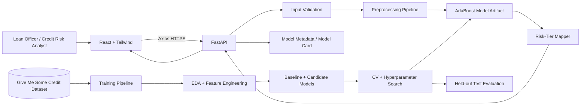

# High-Level Design
## Architecture

## Responsibilities
React: UI. FastAPI: validation/inference. Pipeline: transformations. AdaBoost: prediction. Tier mapper: operational category. Training pipeline: EDA, features, model selection, tuning and evaluation.

## Scalability
Keep FastAPI stateless. Scale horizontally only when traffic justifies it. Do not introduce microservices or databases without a demonstrated need.

## Reliability
Validate requests, load the artifact at startup, expose health checks, use stable error codes and make prediction deterministic for a fixed artifact/input.

## Security
HTTPS, validation, rate limiting when public, secret management, dependency scanning and no sensitive data in logs.
