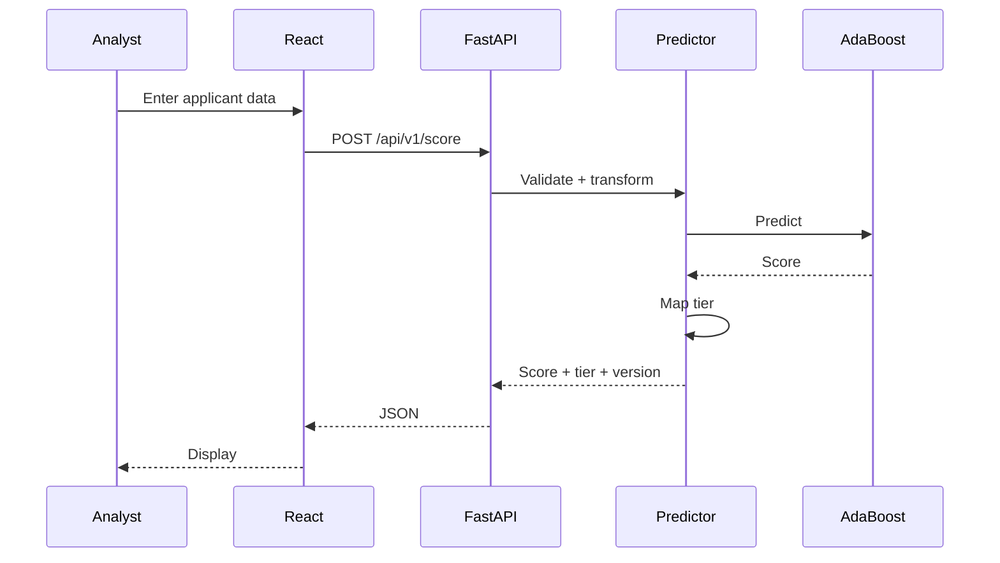

# Low-Level Design
## Training
```text
training/
  data/ ingestion.py validation.py split.py
  eda/ distributions.py missingness.py target_analysis.py
  features/ preprocessing.py feature_engineering.py
  models/ baseline.py adaboost.py tuning.py evaluation.py threshold.py
  experiments/
  artifacts/
```

## Backend
```text
backend/app/
  main.py schemas.py
  routes/health.py scoring.py model.py
  services/predictor.py model_registry.py
  middleware/error_handler.py
```

## Frontend
```text
frontend/src/
  components/
  pages/
  services/
  hooks/
  types/
  utils/
```

## Predictor
load_model → validate_features → transform → predict → map_risk_tier → return metadata.

## Sequence

